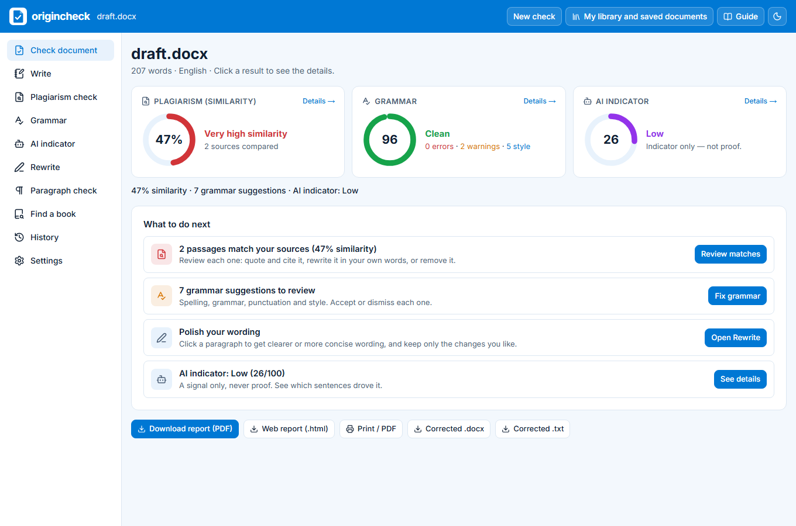
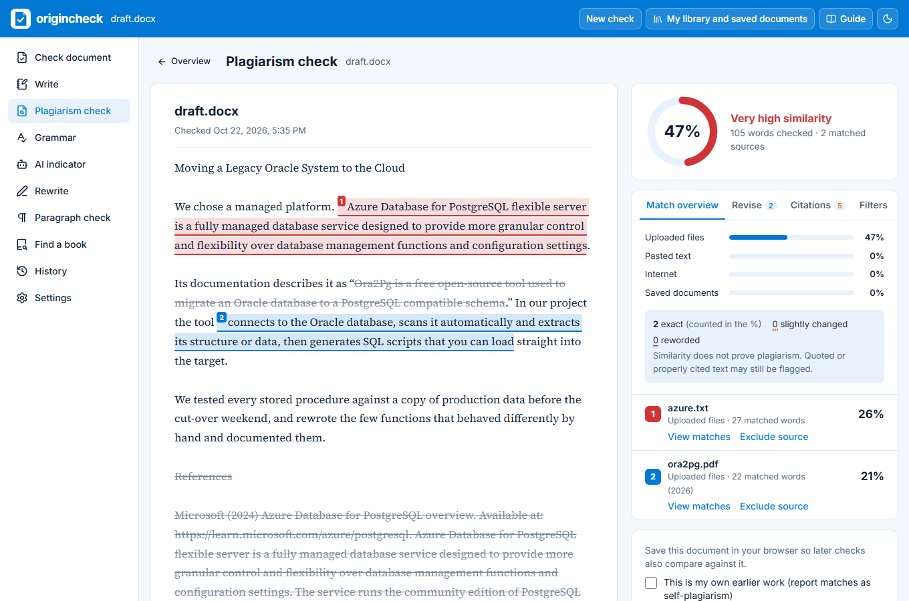
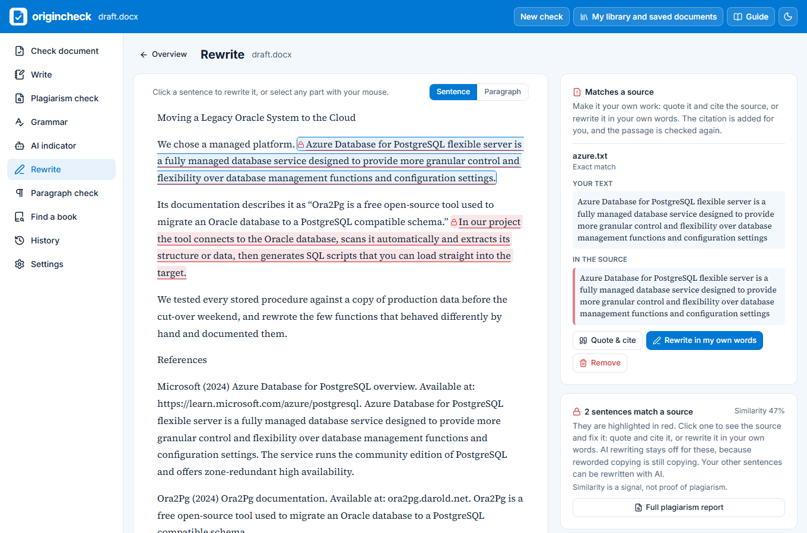
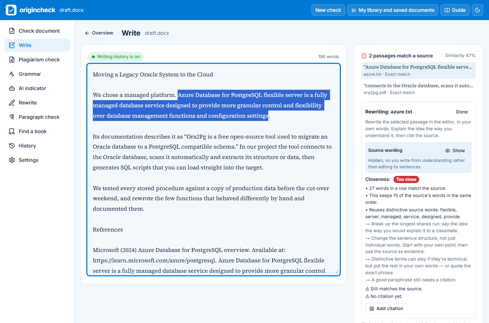
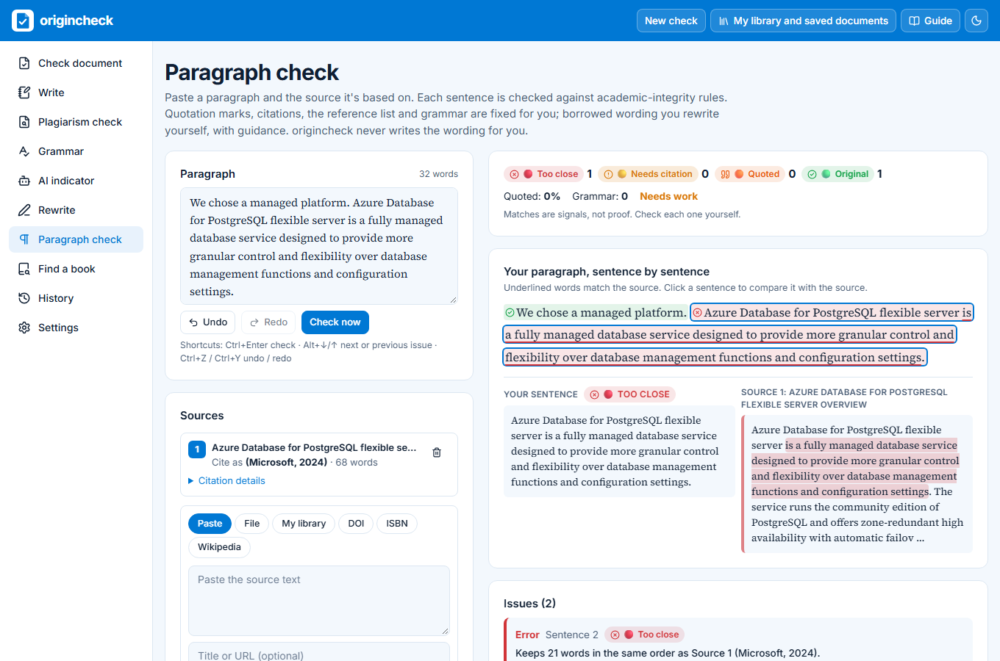
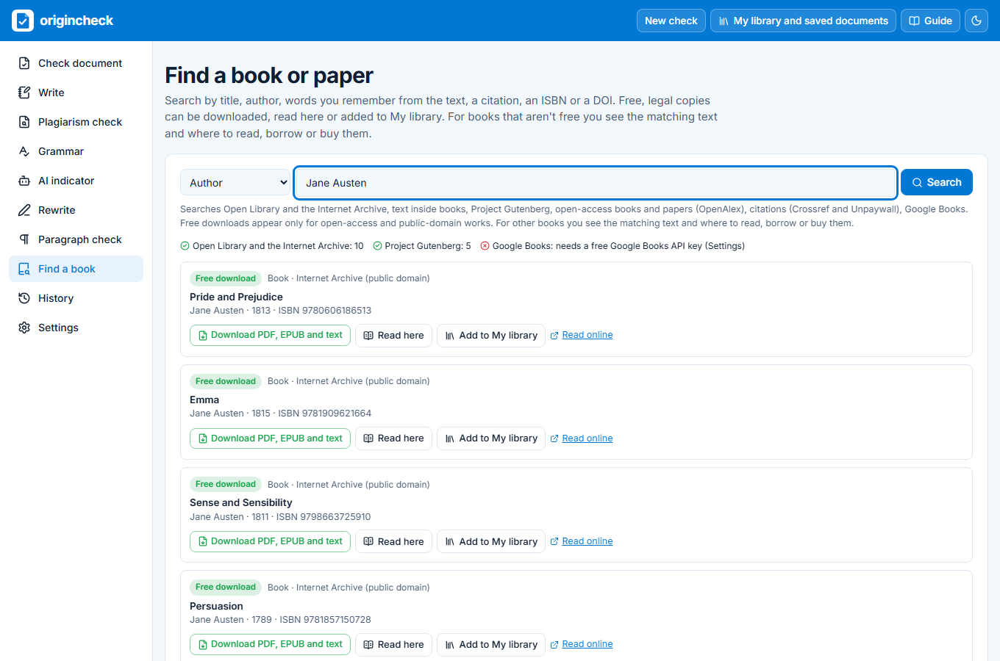
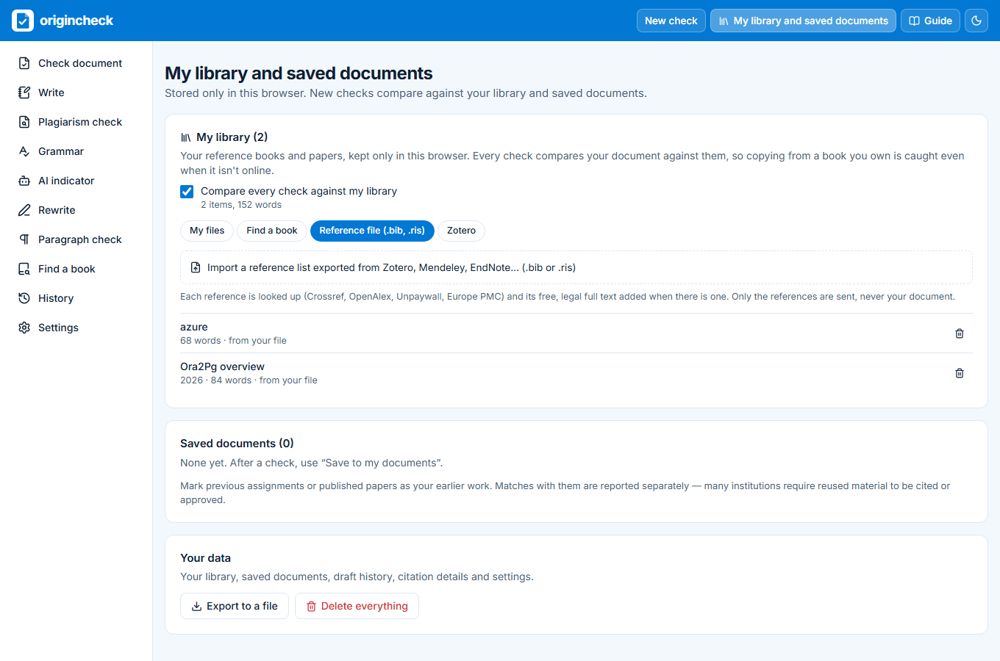
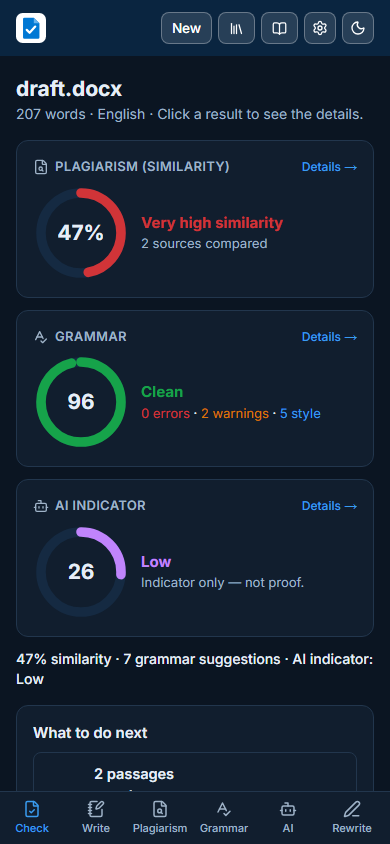
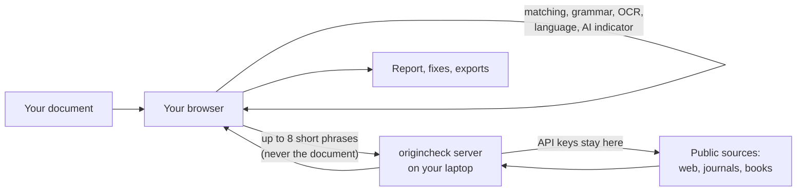

# origincheck

**Check your writing for plagiarism, grammar and AI text, fix what it finds, and find the books and papers you need. One free, open-source app that runs on your laptop.**

[](https://github.com/Devisetty08/origincheck/actions/workflows/ci.yml)
[](https://github.com/Devisetty08/origincheck/releases/latest)
[](LICENSE)


[Quick start](#quick-start) · [Screenshots](#screenshots) · [Examples](example/README.md) · [Feature guide](#feature-guide) · [FAQ](#faq) · [Changelog](CHANGELOG.md) · [Licence](LICENSE) · [Third-party licences](THIRD_PARTY_LICENSES.md)


<sub>The overview after adding a draft and its two sources: three scores and one next step per check.</sub>

---

## Contents

- [Why this exists](#why-this-exists)
- [What it does](#what-it-does)
- [Quick start](#quick-start)
- [Screenshots](#screenshots)
- [How it works](#how-it-works)
- [Where it searches](#where-it-searches)
- [Feature guide](#feature-guide)
- [Settings and API keys](#settings-and-api-keys)
- [Privacy](#privacy)
- [How it compares](#how-it-compares)
- [Limitations](#limitations)
- [FAQ](#faq)
- [Command-line tool and Prose Inspector](#command-line-tool)
- [Contributing](#contributing)
- [Disclaimer](#disclaimer)
- [Credits and licences](#credits-and-licences) ([LICENSE](LICENSE), [THIRD_PARTY_LICENSES.md](THIRD_PARTY_LICENSES.md))

## Why this exists

Checking one piece of writing properly meant opening a lot of apps and websites: a plagiarism checker, a grammar checker, an AI detector, a citation formatter, a library catalogue, Google Scholar, a few journal databases, and a search engine to track down the book you quoted. Each one has its own login, its own limits and its own idea of what a "result" is. Searching across all of them by hand is slow, and it's easy to miss something.

origincheck is an attempt to make that one simple path. You add your document once. It checks it against the web, journals, books and your own sources, shows you what needs fixing, helps you fix it properly, and helps you find and cite the sources you need, all in one app on your own laptop.

It's built for students, researchers and anyone handing in written work who wants to know it's genuinely theirs before someone else checks it.

## What it does

- **Plagiarism check.** It matches your document against your own sources, the web, journals, books, your earlier drafts and your reference library. Exact copying, lightly edited copying and reworded passages (same meaning, different words) are reported separately, and translated copying can be caught too.
- **Fix, not just flag.** For each match you can quote and cite it, cite a paraphrase, rewrite it in your own words while a closeness meter tells you when it's no longer too close, or remove it. Each passage is checked again as soon as you fix it.
- **Paragraph check.** It checks one paragraph sentence by sentence against academic-integrity rules: copied wording, patchwriting, uncited quotes and ideas, too much quoting, and citation format. Quotation marks, citations and the reference list are fixed for you, and the wording is left for you to write.
- **Referencing.** It finds citations with no reference entry, entries you never cite, statistics and "studies show" claims with no source, and over-long quotations. Citations and reference lists come in APA 7, Harvard and IEEE.
- **Grammar and style.** Spelling, grammar, punctuation and style are checked on your own device, with readability, tone, and definitions and synonyms for any word.
- **AI indicator.** Optional. It estimates how likely the text is to be machine-written, sentence by sentence and with the reasons. It's always a signal, never a verdict.
- **Find a book or paper.** Search by title, author, words from the text, a citation, an ISBN or a DOI, across Open Library, the Internet Archive, Project Gutenberg, open-access literature, Crossref and Google Books at once. Free, legal copies can be downloaded or read in the app; other books show where to borrow or buy them.
- **My library.** Keep the books and papers you own (PDF, EPUB, Word), your Zotero items or a .bib export. Every check compares against them, so copying from a book that isn't online is still caught.
- **Writing history.** The built-in editor can record how your text grows (typed, pasted or AI-assisted), so you can show your process if your work is ever questioned.
- **Reports.** A PDF or HTML originality report, a corrected .docx, and exports for every page.
- **Confidential words.** List your employer's, clients' or internal systems' names, and it points out every one before you hand the work in.
- **Command line.** A Python tool for batches of documents, with the same matching as the app.

## Quick start

You need [Node.js 22](https://nodejs.org/) on Windows, macOS or Linux.

```
git clone https://github.com/Devisetty08/origincheck.git
cd origincheck/web
npm ci
npm run dev
```

Open **http://localhost:3100** and drop in a document. The plagiarism check, grammar check, book search and all the free sources work straight away, with no account and no keys. Add keys later in the app's Settings page if you want more sources (see [Settings and API keys](#settings-and-api-keys)).

To try it with real data, use the files in [`example/`](example): `draft.docx` as the document and the two files in `example/references/` as sources. You should see a 47% similarity index. The same folder has a paragraph to try in Paragraph check, a `.bib` file for My library, and the reports origincheck made from them (PDF, web report, Paragraph check report and .docx), so you can see the results before installing anything. See [example/README.md](example/README.md).

## Screenshots

### Plagiarism check

Every matching passage is highlighted and numbered by source, with a ranked source list and each source passage shown next to yours.



### Rewrite

Sentences that match a source are highlighted in red. Click one to see the source wording and fix it right there. Your own sentences can get a rewrite suggestion.



### Write

A built-in editor with writing history. Pick a matched passage and rewrite it while a meter tells you how close you still are, with the source hidden.



### Paragraph check

One paragraph, sentence by sentence: each sentence gets a status, matched words are underlined, and the source is shown alongside.



### Find a book or paper

One search across Open Library, the Internet Archive, Project Gutenberg, open-access literature, Crossref and Google Books, showing what each source found.



### My library

Your own books and papers, compared in every check: add files, search for free books, import a .bib or .ris file, or connect Zotero.



### On a phone, in dark mode



## How it works



- **Most of the work happens in your browser.** Reading files (including OCR of scanned PDFs), matching, paraphrase detection, grammar, language detection and the AI indicator all run on your device.
- **The server is small, and it's on your laptop too.** It holds the API keys, talks to the outside services, and only ever accepts short phrases, never your document. It also blocks private network addresses, caps sizes and time limits, and never logs what you write.
- **Matching is explainable.** The text is cut into overlapping 5-word fingerprints. Runs of 8 or more matched words count towards the similarity index, and each matched word is credited to one source. On top of that, an edit-distance check finds lightly changed passages, and multilingual sentence embeddings find reworded ones. The formulas are in [How the scores work](#how-the-scores-work).

## Where it searches

When you add a document, origincheck picks up to 8 short, distinctive phrases from it. It skips quotations, cited sentences and the bibliography, then searches:

| Group | Sources |
|---|---|
| The web | Wikipedia, and Tavily web search (free plan, no card). Optionally Brave, Jina or Google. |
| Journals and papers | Crossref, OpenAlex, PubMed, arXiv, Semantic Scholar, CORE, Europe PMC, DataCite, OSF Preprints and INSPIRE-HEP, with Unpaywall finding free legal copies |
| Books | Open Library (including the text inside scanned books) and Google Books |
| Classic books and poems | Project Gutenberg and PoetryDB |
| Your own | Uploaded files, pasted text, web pages (with the Wayback Machine if a page has gone), your reference list, saved documents, earlier drafts and My library |

The page shows which services found something, which found nothing, and which couldn't search and why. With a translation server set up, documents in other languages are also searched in English.

Two extras sit at the bottom of the plagiarism page. **Copyleaks** (paid) scans the whole document against the web, journals and its own database of submitted papers, but only when you press its button and after a notice. **Check externally** copies your text and opens Duplichecker or CopyKiller in a new tab, for you to paste in yourself.

## Feature guide

### Check document

Upload a .docx, .pdf, .epub, .txt, .md, .html or .rtf file, or paste text. Scanned PDFs are read with OCR in the browser. All the checks start at once, and the overview shows the scores with a short "What to do next" list.

### Plagiarism check

| How it looks | What it means | Counts towards the % |
|---|---|---|
| Solid highlight | Exact match, same wording | Yes |
| Dotted orange underline | Slightly changed, a few words swapped | No, listed separately |
| Double purple underline | Reworded, same meaning in different words | No, listed separately |

For each match: **Mark as quoted & cited**, **Cite this source**, **Rewrite in my own words** (the source is hidden while you write, and a meter tells you when it's no longer too close), **Remove**, or **Fix in Paragraph check**. "Fix these sections first" ranks your sections by how much of each matches a source. The **Citations** tab checks the rest of your referencing.

### Rewrite

Matched sentences are shown in red, and you fix them yourself: quote and cite, rewrite with the meter, or remove. For your own sentences, a rewrite suggestion is available: clearer, shorter, more formal, more casual, plain language, or without filler. You see your original next to the suggestion and keep only the changes you want.

By default the suggestions come from **Qwen2.5 7B** (Apache-2.0), running on your laptop through [Ollama](https://ollama.com/). Install Ollama, run `ollama pull qwen2.5:7b` once (about 4.7 GB), and your text never leaves your machine. In Settings you can switch to any other Ollama model, to Anthropic's Claude (paid, capped per month), or to a free-model gateway running on your laptop, [FreeLLMAPI](https://github.com/tashfeenahmed/freellmapi) or [OmniRoute](https://github.com/diegosouzapw/OmniRoute). With a gateway, your passage goes to one of its free providers. That's for personal use only, so it's refused on hosted deployments. Pin one model, and keep OmniRoute's prompt compression off for this. Any change you keep is labelled AI-assisted.

The AI never rewords text that matches a source, and there's no "humanize" or "beat the AI detector" mode.

### Write and writing history

The built-in editor updates every check as you type, and lists the passages that match a source so you can rewrite them in place. Writing history is on by default, with a visible notice and a switch to turn it off. It saves a version after every 5-second pause and records where each part came from (typed, pasted, AI-assisted or imported), for example "62% typed, 25% pasted, 13% AI-assisted". You can export it as PDF or JSON, or delete it. It never records keystrokes or screens, never watches anything outside origincheck, and never leaves your browser.

### Paragraph check

Paste one paragraph and the sources it's based on: pasted text, a file, My library, a DOI, an ISBN or a Wikipedia link, or turn on "Find possible sources". Each sentence gets a status:

| Status | Meaning |
|---|---|
| 🟢 Original | Your own wording, cited where it needs to be |
| 🟡 Needs citation | Your own wording, but it draws on a source and has no citation |
| 🟠 Quoted | Quoted and cited. Fine, but it counts towards the quoting limit |
| 🔴 Too close | Copied wording or patchwriting |

| Check | What it looks for | Severity |
|---|---|---|
| Copied wording | 6 or more words in a row matching a source, outside quotation marks | Error |
| Patchwriting | The same content words (stemmed) in much the same order as one source sentence, or 60% of them taken from it | Error |
| Quote without citation | A quotation with no citation in the same sentence or the next | Error |
| Borrowed idea without citation | A sentence that draws on a source, even rewritten, with no citation | Error |
| Quote too long | A quotation over 40 words (adjustable) | Warning |
| Too much quoting | Over 30% of the paragraph in quotation marks | Warning |
| Citation without reference | A citation that matches none of your sources | Warning |
| Citation format | The wrong style, e.g. "(Microsoft 2024)" in APA, which wants "(Microsoft, 2024)" | Warning |
| Grammar and spelling | Harper, on your device | Suggestion |

One click, always previewed and undoable, adds quotation marks and citations, fixes a citation's format, or applies grammar fixes you pick. The reference list is built with [citation-js](https://github.com/citation-js/citation-js) and the official CSL styles. **Paragraph check never writes wording for you.** When a sentence is too close, a guided editor hides the source, measures your new sentence as you type, keeps the citation, and asks questions about your own work instead of offering sample sentences. Exports are .docx, .txt and an HTML report. Shortcuts: Ctrl+Enter checks, Alt+↓/↑ moves between issues, Ctrl+Z/Ctrl+Y undoes and redoes.

### Find a book or paper

Search by anything, title, author, words in the text, a citation, an ISBN or a DOI. A pasted DOI, ISBN or full reference is recognised automatically. Results appear as you type, and the page shows what each source found:

| Label | What you get |
|---|---|
| Free download | A legal free copy (PDF, EPUB or plain text) from a public-domain or open-access source. **Read here** opens the full text with your search words highlighted. **Add to My library** keeps it for your checks. |
| Matching text | The passage inside the book that matches your search, as Open Library or Google Books publishes it, with a link to read more |
| Details | For books that aren't free: **Where to get it: free or paid?** |

"Where to get it" lists every option with a label: **Free** (free to read online), **Free to borrow** (Open Library, with whether every copy is on loan and how many are waiting), **Preview** (some pages on Google Books), **Library** (WorldCat shows the nearest library), **Paid** (the e-book price on Google Play in your country, or bookshop prices compared on BookFinder), or **Restricted** (only for print-disabled readers). E-book prices need a free Google Books key.

### My library

Open it from the books icon at the top. Add the books and papers you own (PDF, EPUB, Word and more; DRM-protected e-books can't be read), free books from the search, a .bib or .ris export from Zotero, Mendeley or EndNote (each reference's free full text is added when there is one), or your Zotero library with your own key. Every check compares your document against the library, and Paragraph check can use it as a source.

### More

- **Grammar:** each suggestion has Accept and Dismiss, plus definitions and synonyms, readability, tone and a corrected .docx.
- **AI indicator:** off by default. When on, it gives a sentence heatmap and the reasons, and needs at least 150 words.
- **History:** your scores across drafts, with a chart.
- **Download report:** a PDF originality report with a cover page, your document highlighted by source, the similarity breakdown, the top sources, the settings used, and a page on grammar, the AI indicator and writing history. There's an HTML version too, which documents in non-Latin scripts such as Korean get.

### How the scores work

- **Similarity index:** exactly matched words ÷ words checked. Quotes and the bibliography can be left out. Under 15% is green, 15–24% amber, 25–39% orange, 40%+ red.
- **Writing score:** `100 − (weighted issues per 100 words × 2)`. Errors count 3, warnings 1 and style suggestions 0.5.
- **AI indicator:** 60% a RoBERTa detector and 40% a language-model signal (how predictable the wording is, and how much that varies between sentences). Under 30 is low, 30–70 unclear, over 70 high.

## Settings and API keys

Nothing needs a key to start. To turn on more, open **Settings** in the app, paste a key and press **Save settings**. Keys are saved on your laptop in `web/.env.local` (git ignores it) and work immediately. After saving, the page only shows whether a key is set, never the key itself.

| Setting | What it gives you | Where to get it |
|---|---|---|
| Contact email | Fewer rate limits from Wikipedia, Crossref and OpenAlex | Your own email |
| Unpaywall email | Free legal copies of papers | Your own email |
| Tavily key (free, no card) | Web search | [tavily.com](https://www.tavily.com/) |
| Google Books key (free) | Text inside books, previews, e-book prices | [Google Cloud console](https://console.cloud.google.com/apis/library/books.googleapis.com) |
| CORE key (free) | CORE's open-access papers | [core.ac.uk/services/api](https://core.ac.uk/services/api) |
| Semantic Scholar key | Fewer rate limits | [semanticscholar.org/product/api](https://www.semanticscholar.org/product/api) |
| Zotero user ID and key (free) | Importing your Zotero library | [zotero.org/settings/keys](https://www.zotero.org/settings/keys) |
| Ollama | Rewrite on your laptop (the default) | [ollama.com](https://ollama.com/) |
| Gateway address, key and model | Rewrite through FreeLLMAPI or OmniRoute (personal use), capped at 1,000 requests a month | [FreeLLMAPI](https://github.com/tashfeenahmed/freellmapi), [OmniRoute](https://github.com/diegosouzapw/OmniRoute) |
| LibreTranslate server | Searching in English for documents in other languages | [Self-host](https://github.com/LibreTranslate/LibreTranslate) or [libretranslate.com](https://libretranslate.com/) |
| Brave Search key (paid) | More web search, capped at 800 a month | [brave.com/search/api](https://brave.com/search/api/) |
| Anthropic key (paid) | Rewrite with Claude, capped at 500 requests a month | [console.anthropic.com](https://console.anthropic.com/) |
| Copyleaks email and key (paid) | The full-document Copyleaks scan, capped at 20 a month | [copyleaks.com](https://copyleaks.com/) |
| AI indicator, confidential words | The AI estimate; names to keep out of your work | Switches and fields in Settings |

**Costs stay under control.** Nothing that charges per use is on by default. Every paid service needs its own key and has a monthly cap that's checked before every call, retries included: Tavily 900 credits, Brave 800 searches, Anthropic 500 requests, Copyleaks 20 scans, and the free-model gateway 1,000 requests. When a cap is reached, the call simply isn't made. Usage and caps are shown in Settings.

**Each service's rules are followed.** Brave results are never cached, as its terms require, and are shown with "POWERED BY BRAVE". Wikipedia text is shown with its article link and "Wikipedia contributors" (CC BY-SA). Other results are cached for an hour at most, a contact email is sent where a service asks for one, and rate limits are respected.

## Privacy

Your document, saved documents, library, history and settings stay in your browser. Anything that has to leave goes only after a notice telling you where.

| Feature | What's sent, and to whom |
|---|---|
| Searching sources | Up to 8 phrases of at most 16 words, to the sources you ticked. The server refuses anything longer. |
| Find a book, My library | What you type in the search (never your document); for "Where to get it", the title, author, ISBN and your country; for a reference file, its references; for Zotero, your key, to read your own library |
| Paragraph check lookups | Only the DOI, ISBN or Wikipedia title you enter, plus up to 4 short phrases if you turn on "Find possible sources" |
| Word lookup | The one word |
| Rewrite | Nothing with Ollama. With Anthropic or a gateway, the passage you picked. |
| OCR, language, tone, AI indicator, writing history | Nothing. These run in your browser. |
| LanguageTool (optional) | The document text, to the LanguageTool server you set up |
| Copyleaks (optional, on request) | The whole document. It isn't added to their database, and is deleted after 24 hours. |

## How it compares

Most plagiarism and writing tools give you a score, or offer to reword your text until the score drops. origincheck is built around a different idea: helping you make the work genuinely yours, and showing you how close you are.

- **One place instead of many.** Checking, fixing, citing and finding sources happen in one app, instead of a dozen tabs.
- **Free and open source.** Anyone can read how the scores are calculated, and run it on their own laptop.
- **Your document stays with you.** The heavy work runs in your browser. Searches send short phrases only, and every outside service is named before anything is sent.
- **It teaches the fix.** The source is hidden while you rewrite, and a meter tells you as you type when your wording is your own. Paragraph check fixes the mechanics and leaves the words to you.
- **It catches more than copy-paste:** patchwriting, reworded passages, translated text, and missing or wrong citations.
- **Evidence of your own process.** Writing history shows how a document was written, and it stays in your browser.
- **Honest about what it can't see,** and it never presents a score as proof.

## Limitations

- **No private databases.** Paid services also compare against private collections of journals and past student papers. origincheck searches public sources, so your institution's report may find matches this one doesn't. The optional Copyleaks scan narrows the gap.
- **Scores aren't proof.** A match can be a properly quoted line or a common phrase. AI detection is often wrong, especially on short, formal, technical or non-native English text.
- **It doesn't search every sentence.** By default it searches 8 phrases per document. Raise "Passages searched per run" in Settings for long documents.
- **Paywalled papers** are matched on their abstracts only. Add the full text as a source if you have it.
- **No copies of copyrighted books.** Full texts come only from open-access and public-domain sources. For the rest, add the copy you own.
- **English only for some checks.** Grammar, tone and OCR are English-only, and OCR covers the first 30 pages.
- **Translated copying** is caught only with a translation server set up, and only for documents in Latin script or Korean.
- **It needs its small server.** It runs on your laptop with Node.js, or on a host such as Vercel. A static site such as GitHub Pages can't run it.

## FAQ

**Is it free?**
Yes. It runs on your laptop, and every source it uses by default is free. A few optional services are paid, and each is off until you add its key, with a monthly cap.

**Does my document leave my laptop?**
Not the document itself. Searches send up to 8 short phrases. Rewrite with the default local model sends nothing. The only feature that sends the whole document is the optional Copyleaks scan, and only after you confirm.

**Will it get me a copy of any book?**
Only when a free, legal copy exists: public-domain books (Project Gutenberg, the Internet Archive) and open-access books and papers. For other books it shows the matching text and where to borrow or buy them, with whether that's free or paid.

**Can it make my text pass a plagiarism or AI checker?**
No, and it won't. It has no paraphraser for copied text and no "humanizer". It helps you quote, cite and rewrite in your own words, which is the only fix that makes the work genuinely yours.

**Does a high similarity score mean I plagiarised?**
No. It means shared wording. Properly quoted and cited passages, common phrases and technical terms all count as shared wording. Look at each match, and fix the ones that aren't credited.

**Can I put it online for others?**
Yes. Import the repo in [Vercel](https://vercel.com/) with `web` as the root directory, add your keys as environment variables, and add `ONNXRUNTIME_NODE_INSTALL=skip`. Personal features (Zotero import and the free-model gateway) are refused on a hosted deployment, because they use your own accounts.

**Which AI does Rewrite use?**
Qwen2.5 7B on your laptop by default. You can switch to another Ollama model, Anthropic's Claude, or a free-model gateway in Settings. Paragraph check never uses AI to write.

## Command-line tool

`origincheck.py` checks a document against a folder of sources, which is handy for batch work. It uses the same matching as the app and gives the same index for the same inputs.

```
pip install -r requirements.txt
python origincheck.py example/draft.docx -s example/references --exclude-quotes --exclude-bib
```

```
Similarity index: 47%
   25.7%  azure.txt
   21.0%  ora2pg.pdf
```

It writes a colour-coded HTML report, like [example/reports/command_line_report.html](example/reports/command_line_report.html). Options: `-s DIR` (a source folder, repeatable), `-o FILE`, `--exclude-quotes`, `--exclude-bib`, `--min-words N`, `--ngram N`, `--exclude-source-pct X`, `--web` (Brave, needs `BRAVE_API_KEY`), `--save-to-repo`, `--no-repo` and `--json`.

**Prose Inspector** (`prose-inspector/`) is a small Streamlit app that reports sentence rhythm, stock phrases and repetition. It only analyses; it doesn't rewrite.

```
pip install -r prose-inspector/requirements.txt
streamlit run prose-inspector/app.py
```

## Contributing

Issues and pull requests are welcome. If you find a security problem, please report it privately as [SECURITY.md](SECURITY.md) explains, not in a public issue. Good first PRs:

- **A new search source:** write an adapter in `web/src/server/adapters/` following `types.ts`, register it in `adapters/index.ts`, and add tests for success, no results, errors, rate limits and timeouts. Only public APIs that allow automated access, please.
- **More citation styles:** add a CSL style to `web/public/csl/` and wire it into `lib/paragraph/citations.ts`.
- **Grammar and OCR for more languages.**
- **EPUB support in the command-line tool.**

```
cd web
npm test                             # unit tests; every external API is mocked
npm run build && npx playwright test # end-to-end tests, desktop and mobile
npm run lint
```

CI ([`.github/workflows/ci.yml`](.github/workflows/ci.yml)) runs lint, the type check, the unit tests, the build and the end-to-end tests on every push.

```
web/                    the app (Next.js)
  src/app/api/          server routes: search, books, zotero, fetch-url, references, doi,
                        words, improve, paid, settings, config
  src/server/           source adapters, search orchestrator, book finder, safe page fetcher,
                        rate limiter, usage caps
  src/lib/              matching, citations, import, exports; lib/paragraph/ for Paragraph check
  src/components/       the interface
  src/workers/          matching, embedding, AI-indicator and Paragraph check workers
docs/screenshots/       the images in this README
example/                sample inputs, and the reports origincheck made from them
origincheck.py          command-line tool
prose-inspector/        Streamlit writing-pattern report
```

## Disclaimer

origincheck gives signals for a person to judge, not verdicts. A similarity or AI score is never proof of misconduct, and the app doesn't replace your institution's own checks or its rules. Follow your course's rules on citation, reuse and AI.

It uses public APIs under their own terms. Keep to them, especially for paid services and for free tiers meant for personal use. It never downloads copyrighted books, and it has no feature for disguising copied or AI-written text.

## Credits and licences

origincheck is released under the [MIT licence](LICENSE). You can use, copy, change and share it, including commercially, as long as you keep the copyright notice.

It stands on a lot of open-source work, including [Harper](https://github.com/Automattic/harper), [Transformers.js](https://github.com/huggingface/transformers.js), [pdf.js](https://github.com/mozilla/pdf.js), [mammoth.js](https://github.com/mwilliamson/mammoth.js), [Readability](https://github.com/mozilla/readability), [citation-js](https://github.com/citation-js/citation-js), [Next.js](https://github.com/vercel/next.js) and [React](https://github.com/facebook/react). Matched Wikipedia text is CC BY-SA and is always shown with its article link.

**[THIRD_PARTY_LICENSES.md](THIRD_PARTY_LICENSES.md)** lists everything origincheck uses, with versions and licences:

- the libraries bundled with the app (for example Harper, Transformers.js, pdf.js, citation-js and the CSL styles)
- the AI models it downloads on first use
- the online services it calls, and their terms
- the software you can run alongside it (Ollama, LibreTranslate, FreeLLMAPI and OmniRoute)
- the Python packages behind the command-line tool
