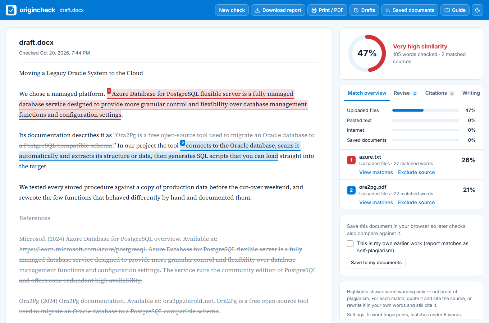
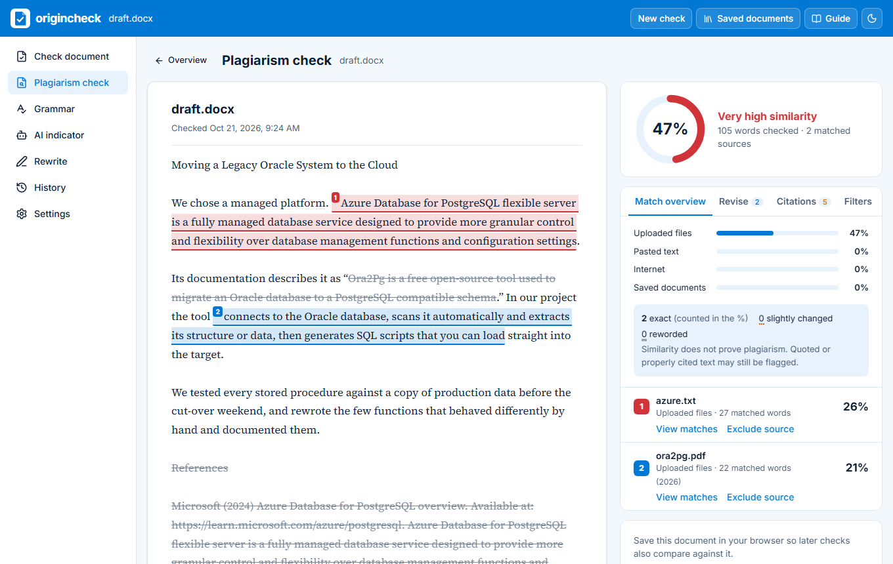

# origincheck

origincheck is a free, open-source writing checker. You give it an essay, report or thesis chapter, and it tells you three things:

- which parts match something already published (plagiarism check)
- where the spelling, grammar or style needs work
- how likely the text is to be machine-written, if you switch that on

Then it helps you fix what it found. You can quote and cite a matched passage, rewrite it in your own words, or tidy up your own sentences.

Your document stays in your browser. When origincheck searches the web or journals, it sends a few short phrases, never the whole document.

A word of caution: these scores are signals, not proof. A match can be a properly quoted line or a common phrase, and AI detectors are wrong often, especially on formal, technical or non-native English writing. The app says this next to every score, and so do we.



## Getting started

You need [Node.js 22](https://nodejs.org/).

```
git clone https://github.com/Devisetty08/origincheck.git
cd origincheck/web
npm ci
npm run dev
```

Open http://localhost:3100 and drop in a document. The plagiarism check, grammar check and the free sources work straight away. You don't need any keys to try it.

## What's in the app

**Check document.** Upload a .docx, .pdf, .txt, .md, .html or .rtf file, or paste text. Scanned PDFs are read with OCR in the browser. All the checks start at once, and the overview shows the scores with a short "what to do next" list.

**Plagiarism check.** Your document with every matching passage highlighted and numbered by source, a ranked list of sources, and each source passage shown next to yours. There are three kinds of match:

| How it looks | What it means | Counts towards the % |
|---|---|---|
| Solid highlight | Exact match, same wording | Yes |
| Dotted orange underline | Slightly changed, a few words swapped | No, listed separately |
| Double purple underline | Reworded, same meaning in different words | No, listed separately |

For each match you can mark it as quoted and cited, cite the source, rewrite it in your own words, or remove it. When you rewrite, the source text is hidden and a meter tells you whether your version is still too close. Citations come in APA 7, Harvard and IEEE.

**Rewrite.** Your document with every sentence that matches a source highlighted in red, plus the similarity score. Click a red sentence to see the source wording and fix it right there: quote and cite it, rewrite it yourself, or remove it. After each fix the passage is checked again. Click any of your own sentences (or switch to whole paragraphs) to get a rewrite suggestion: clearer, shorter, more formal, more casual, plain language, or without filler. You see your original next to the suggestion and keep only the changes you like.

The AI won't reword the red sentences. Rewording copied text is still copying, so those you quote, cite or rewrite yourself. There's also no "humanize" or "beat the AI detector" mode, and there won't be.

**Write.** A built-in editor where every check updates as you type. It can keep a writing history (see below).

**Grammar.** Spelling, grammar, punctuation and style, checked on your own device. Each suggestion has Accept and Dismiss. You also get definitions and synonyms for any word, a readability score, the tone of the text, and a corrected .docx.

**AI indicator.** Off by default. When on, it estimates how likely the text is machine-written, shows a sentence-by-sentence heatmap and explains why. It's an estimate, never a verdict.

**History.** Your scores across drafts, with a chart.

**Download report.** A PDF originality report: a cover page, your document with matches highlighted in each source's colour, the similarity index with its breakdown (internet, publications, your own sources, saved papers), the top sources, the settings used, and a page on grammar, the AI indicator and writing history. There's an interactive HTML version too. Documents in non-Latin scripts such as Korean get the HTML version, because the PDF fonts can't draw them.



## Where it searches

When you add a document, origincheck picks up to 8 short, distinctive phrases from it. It skips quotations, cited sentences and the bibliography. Then it searches:

- the web: Wikipedia, and web search through Tavily (free plan, no card needed) or, if you add a key, Brave, Jina or Google
- journals and papers: Crossref, OpenAlex, PubMed, arXiv, Semantic Scholar, CORE, Europe PMC, DataCite, OSF Preprints and INSPIRE-HEP, with Unpaywall finding free legal copies
- books: Open Library and Google Books
- classic books and poems: Project Gutenberg and PoetryDB

You can also add your own sources. Upload files, paste text, add a web page, or paste your reference list and let origincheck find the open-access copies. If a web page has gone, the latest copy from the Wayback Machine is used. The results page shows which services found something, which found nothing, and which couldn't search and why.

If you set up a translation server, documents in other languages are also searched in English, so text translated from an English source can still be caught.

At the bottom of the plagiarism page are two extras. Copyleaks (paid) scans the whole document against the web, journals and its own database of submitted papers, but only when you press its button and after a notice that the whole document will be sent. "Check externally" copies your text and opens Duplichecker or CopyKiller in a new tab, so you paste it in yourself. origincheck never sends anything to those sites.

## Rewrite setup

By default Rewrite uses Qwen2.5 7B, an Apache-2.0 model, running on your own computer through [Ollama](https://ollama.com/). It's free and your text never leaves your machine. To set it up once, install Ollama and run:

```
ollama pull qwen2.5:7b
```

It's about 4.7 GB. The first rewrite takes a minute or so while the model loads, and after that each one takes a second or two. We picked Qwen because in side-by-side tests it kept facts such as names, numbers and durations, where the smaller Phi-4-mini sometimes changed them. Still, read every suggested change before you keep it. You can choose any other Ollama model in Settings, or use Anthropic's Claude instead (paid, with a monthly cap).

Any change you keep is labelled AI-assisted in the writing history, the reports and the .docx properties.

## Writing history

The Write page can record how your document grows, so you can show your process if anyone asks. It's on by default. You'll see a "Writing history is on" notice and a switch to turn it off.

It saves a version after every 5-second pause (or when you press Save version) and notes where each part of the text came from: typed, pasted, AI-assisted or imported. You get a summary like "62% typed, 25% pasted, 13% AI-assisted" and a timeline to step through the versions. You can export it as PDF or JSON, or delete it whenever you like.

It never records keystrokes, takes screenshots, watches anything outside origincheck, or sends the history anywhere. It lives in your browser and nowhere else. The export says it's evidence of process, not proof of authorship on its own.

## Settings and API keys

Open Settings in the app, paste a key and press Save settings. Keys are saved on your computer in `web/.env.local`, which git ignores, and they work immediately. Once saved, the page only shows whether a key is set, never the key itself.

| Setting | What it gives you | Where to get it |
|---|---|---|
| Contact email | Fewer rate limits from Wikipedia, Crossref and OpenAlex | Your own email |
| Unpaywall email | Free legal copies of papers | Your own email |
| Tavily key (free, no card) | Web search | [tavily.com](https://www.tavily.com/) |
| Brave Search key (paid, optional) | More web search, capped at 800 searches a month | [brave.com/search/api](https://brave.com/search/api/) |
| Semantic Scholar key | Fewer rate limits from Semantic Scholar | [semanticscholar.org/product/api](https://www.semanticscholar.org/product/api) |
| CORE key (free) | CORE's open-access papers (it won't answer without one) | [core.ac.uk/services/api](https://core.ac.uk/services/api) |
| Google Books key (free) | Search inside millions of books | [Google Cloud console, Books API](https://console.cloud.google.com/apis/library/books.googleapis.com) |
| LibreTranslate server | Searching in English for documents in other languages | [Self-host](https://github.com/LibreTranslate/LibreTranslate) or [libretranslate.com](https://libretranslate.com/) |
| Ollama | Rewrite on your own computer (the default) | [ollama.com](https://ollama.com/) |
| Anthropic key (paid, optional) | Rewrite with Claude, capped at 500 requests a month | [console.anthropic.com](https://console.anthropic.com/) |
| Copyleaks email and key (paid, optional) | The Copyleaks scan, capped at 20 scans a month | [copyleaks.com](https://copyleaks.com/) |
| AI indicator | The AI-likelihood estimate | A switch in Settings |

### Keeping costs under control

Nothing that charges per use is on by default. Every paid service needs its own key and has a monthly cap: Tavily 900 credits, Brave 800 searches, Anthropic 500 requests, Copyleaks 20 scans. The count is checked before every call, retries included. When a cap is reached the call simply isn't made, and the service shows "cap reached". You can see usage and change the caps in Settings. Counts reset each month and are kept in `web/.data/usage.json`, which git ignores.

### The services' rules

| Service | Credit | Keeping results | Worth knowing |
|---|---|---|---|
| Brave Search | Optional, but if shown it must read "POWERED BY BRAVE" with Brave's logo. The app shows the text; add the logo from [Brave's brand page](https://brave.com/brand/) if you rely on the free credit. | Not allowed, so Brave results are never cached | Card required. Use beyond the free credit is billed. No redistributing results or training AI on them. |
| Tavily | Not required | No stated limit | The free plan stops at 1,000 credits rather than billing. Tavily may keep the queries it receives, so only short phrases are sent and the privacy notice says so. |
| Wikipedia | Article link and "Wikipedia contributors" (CC BY-SA), shown with every match | Cached for 1 hour | Needs a User-Agent with contact details |
| CORE | See [CORE's terms](https://core.ac.uk/terms) | Cached for 1 hour | Free key needed. Check the terms before commercial use. |
| Copyleaks | Not required | Scans are deleted after 24 hours and not indexed | Paid credits, results arrive by webhook |
| Anthropic | Not required | Not cached | Paid per request. Only the chosen passage is sent. |
| Crossref, OpenAlex, PubMed and the rest | Shown per source in the report | Cached for 1 hour | Contact email sent, rate limits respected |

## Privacy

Your document, saved documents, history and settings stay in your browser. Anything that has to leave it goes only after a notice telling you where.

| Feature | What's sent, and to whom |
|---|---|
| Searching sources | Up to 8 phrases of at most 16 words, to the sources you ticked. The server refuses anything longer. |
| Translated search | The same short phrases, to your translation server |
| Adding a web page or references | Only the addresses, DOIs and references you enter |
| Word lookup | The one word, to Datamuse, the Free Dictionary API, Wiktionary and Wikidata |
| Scanned PDFs, language detection, tone | Nothing. These run in your browser. |
| Rewrite | Nothing with Ollama. With Anthropic, the passage you picked. |
| Writing history | Nothing |
| LanguageTool (optional) | The document text, to the LanguageTool server you set up |
| Copyleaks (optional) | The whole document. It isn't added to their database and is deleted after 24 hours. |

The server never logs documents, strips keys from anything it logs, and limits how often each visitor can call it. The web-page fetcher refuses private and internal network addresses, even after redirects, and caps size, time and redirects.

## Putting it online

1. Import the repository in [Vercel](https://vercel.com/) and set the root directory to `web`.
2. Add your keys under Settings, Environment Variables. The names are in [`web/.env.example`](web/.env.example). On Vercel the in-app Settings page is read-only.
3. Deploy.

The rate limiter, search cache and pending Copyleaks scans live in memory, so each server instance has its own. For heavy public use, put Vercel's firewall in front and move Copyleaks scans to a shared store such as Upstash Redis. Copyleaks sends results to `PUBLIC_BASE_URL`; when running locally, use a tunnel such as `ngrok http 3100`.

## How the scores work

The similarity index is the number of exactly matched words divided by the words checked. Quotes and the bibliography can be left out. Under 15% shows green, 15 to 24% amber, 25 to 39% orange, and 40% or more red.

Matching works like this. The text is split into words and cut into overlapping 5-word fingerprints. Any word covered by a fingerprint that also appears in a source is marked, and runs shorter than 8 words are dropped. Each matched word is credited to one source, so the source percentages add up to the index. On top of that, MinHash finds likely sentence pairs: an edit-distance check (75% alike or more) confirms "slightly changed" ones, and multilingual sentence embeddings (cosine 0.80 or more) confirm "reworded" ones.

The writing score is `100 − (weighted issues per 100 words × 2)`, where errors count 3, warnings 1 and style suggestions 0.5.

The AI indicator is 60% a RoBERTa detector and 40% a language-model signal (how predictable the wording is, and how much that changes from sentence to sentence). Under 30 is low, 30 to 70 unclear, over 70 high. It needs at least 150 words.

## Limits

- It doesn't have a commercial database. Paid plagiarism services compare against private collections of web pages, journals and past student papers. origincheck searches public sources, so your institution's report may find matches this one doesn't. The Copyleaks option narrows the gap.
- It samples. By default it searches 8 phrases per document. For long documents, raise "Passages searched per run" in Settings.
- Paywalled papers are matched on their abstracts only. If you have the full text, add it as a source.
- Grammar and tone checks are English only. Other languages are detected and skipped, with a note.
- AI detection is unreliable, and the app says so next to every score.
- OCR is English only and covers the first 30 pages. Poor scans can be misread.
- Translated text is caught only when a translation server is set up, and only for documents in Latin script or Korean.

## Command-line tool

`origincheck.py` checks a document against a folder of sources, which is handy for batch work. It uses the same matching as the web app and gives the same index for the same inputs.

```
pip install -r requirements.txt
python origincheck.py example/draft.docx -s example/references --exclude-quotes --exclude-bib
```

```
Similarity index: 47%
   25.7%  azure.txt
   21.0%  ora2pg.pdf
```

It writes a colour-coded HTML report, like [example/sample_report.html](example/sample_report.html).

| Option | What it does |
|---|---|
| `-s DIR` | Folder of sources, read recursively. Repeat it for more folders. |
| `-o FILE` | Where to write the report (default `<document>_similarity.html`) |
| `--exclude-quotes`, `--exclude-bib` | Ignore quoted text and the bibliography |
| `--min-words N`, `--ngram N` | Shortest match counted (default 8) and fingerprint size (default 5) |
| `--exclude-source-pct X` | Drop sources that contribute less than X% |
| `--web`, `--web-queries N` | Also search the web with Brave (needs `BRAVE_API_KEY`) |
| `--save-to-repo`, `--no-repo` | Keep this document for future comparisons, or skip them |
| `--json` | Also write a JSON summary |

## Prose Inspector

`prose-inspector/` is a small Streamlit app that looks at sentence rhythm, stock phrases and repetition in a piece of writing. It only reports; it doesn't rewrite anything.

```
pip install -r prose-inspector/requirements.txt
streamlit run prose-inspector/app.py
```

## Contributing

```
cd web
npm test                             # unit tests; every external API is mocked
npm run build && npx playwright test # end-to-end tests, desktop and mobile
npm run lint
```

CI ([`.github/workflows/ci.yml`](.github/workflows/ci.yml)) runs lint, the type check, the unit tests, the build and the end-to-end tests on every push.

To add a search source, write an adapter in `web/src/server/adapters/` following `types.ts`. It needs an `id`, a `label`, a `group`, a minimum interval that respects the API's rate limit, `missing()` for required keys, and `search(query, { signal })`. Register it in `adapters/index.ts` and add tests to `adapters.test.ts` for success, no results, errors, rate limits and timeouts. Please only add APIs that are public and allow automated access.

```
web/                    the web app (Next.js)
  src/app/api/          server routes: search, fetch-url, references, doi, catalog, words,
                        languagetool, improve, paid, settings, config
  src/server/           source adapters, search orchestrator, safe page fetcher, rate limiter,
                        settings, usage caps, Copyleaks
  src/lib/              matching, hybrid matching, query selection, citations, import, exports
  src/components/       the interface
  src/workers/          matching, embedding and AI-indicator workers
origincheck.py          command-line tool
prose-inspector/        Streamlit writing-pattern report
example/                sample document, sources, report and screenshots
```

## Credits

origincheck stands on a lot of open-source work, including [Harper](https://github.com/Automattic/harper), [Transformers.js](https://github.com/huggingface/transformers.js), [pdf.js](https://github.com/mozilla/pdf.js), [mammoth.js](https://github.com/mwilliamson/mammoth.js), [Readability](https://github.com/mozilla/readability), [Next.js](https://github.com/vercel/next.js) and [React](https://github.com/facebook/react). Matched Wikipedia text is CC BY-SA and is always shown with its article link. The full list, with versions and licences, is in [THIRD_PARTY_LICENSES.md](THIRD_PARTY_LICENSES.md).
